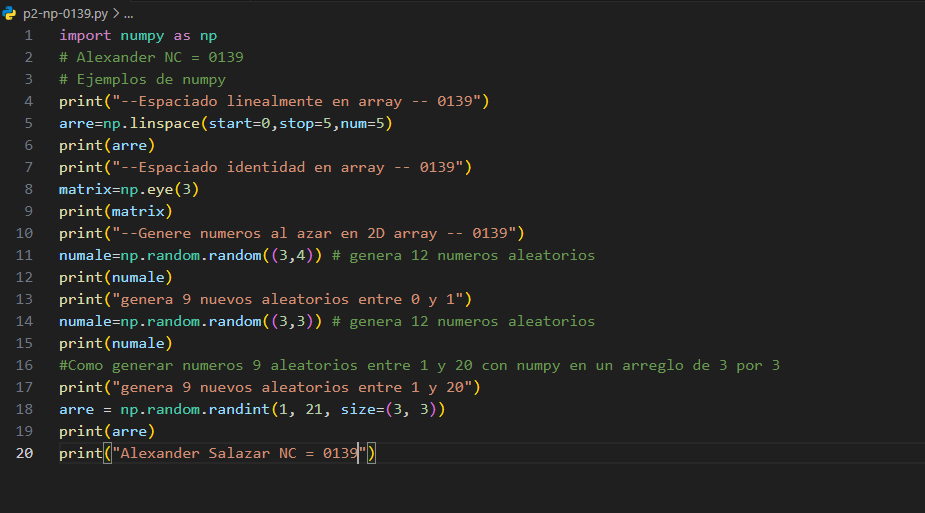
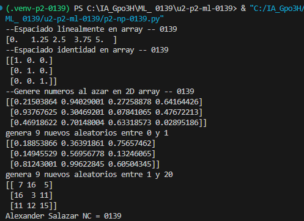

arre: Es la variable donde se guardan los números generados
np: Es el alias de la biblioteca NumPy.
linspace(): Genera una cantidad determinada de números distribuidos uniformemente dentro de un intervalo.
start=0: Indica el valor inicial, que es 0.
stop=1: Indica el valor final, que es 1.
num=5: Indica que se generarán 5 números en total.

## El codigo

# resultado
